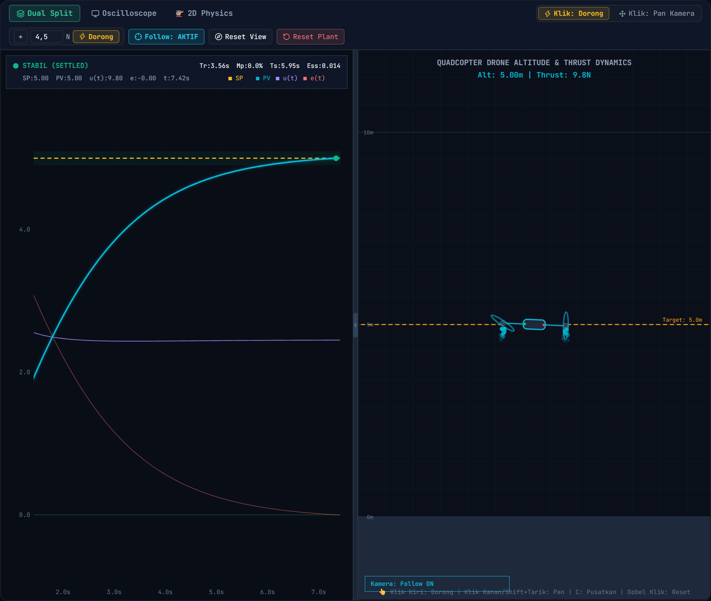
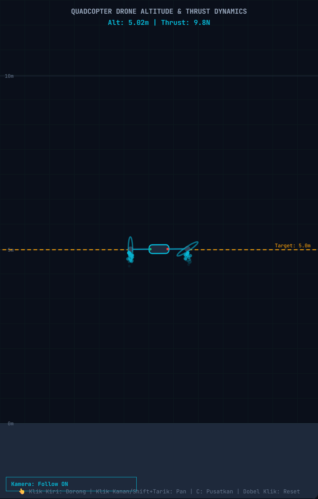
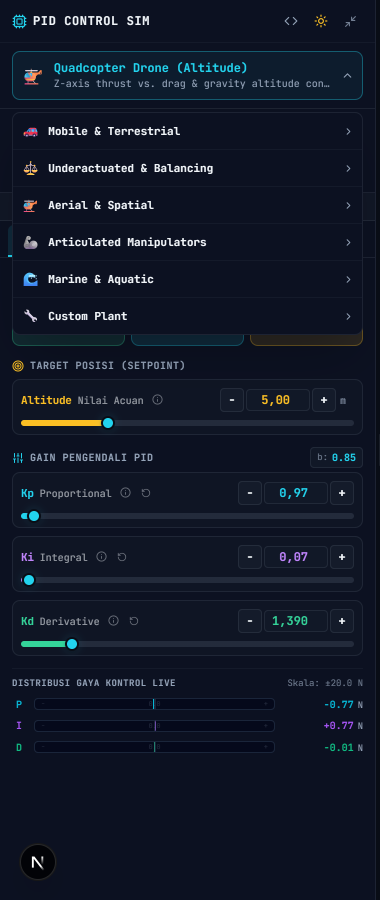
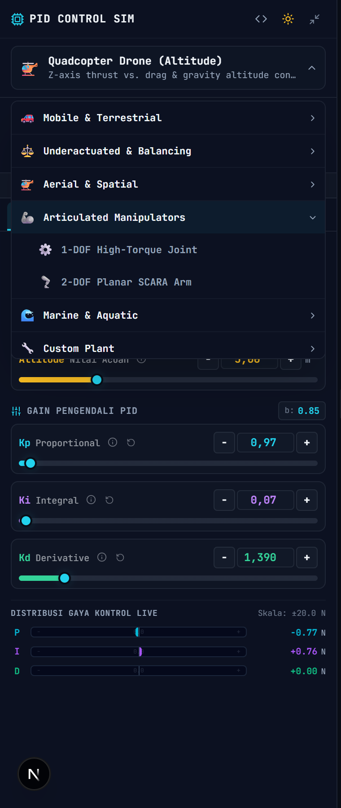
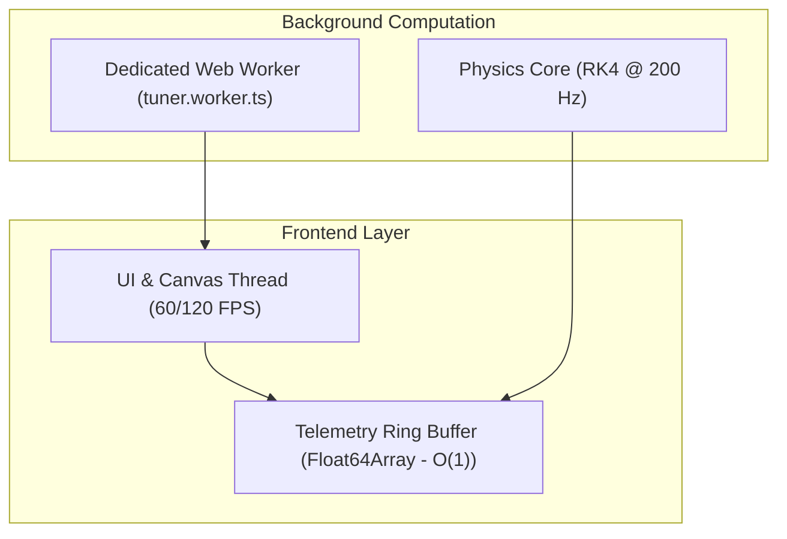

# ⚡ PID Control Sim — Real-Time Multi-Plant Robotics Simulator

[](https://pid-simulation.vercel.app)
[](https://nextjs.org/)
[](https://react.dev/)
[](https://www.typescriptlang.org/)
[](https://tailwindcss.com/)
[](https://developer.mozilla.org/en-US/docs/Web/API/Canvas_API)
[](https://developer.mozilla.org/en-US/docs/Web/API/Web_Workers_API)
[](https://turbo.build/pack)
[](https://opensource.org/licenses/MIT)

> Simulator kendali PID industri berbasis web dengan integrasi numerik Runge-Kutta ke-4 (RK4), visualisasi kinematika 2D multi-archetype, auto-tuning non-blocking via Web Worker, dan telemetri instrumen zero-allocation.

[🌐 Live Demo](https://pid-simulation.vercel.app) • [Fitur Utama](#-fitur-unggulan-core-highlights) • [Formulasi Matematika](#-formulasi-matematis-mathematical-foundations) • [Robotic Archetypes](#-robotic-archetypes) • [Arsitektur Sistem](#-arsitektur-sistem--performa) • [Instalasi](#-instalasi--panduan-cepat)

---

## 🎯 Gambaran Umum (Overview)

**PID Control Sim** adalah platform simulasi sistem kendali lup tertutup (*closed-loop control system*) skala penuh yang dirancang khusus untuk mahasiswa teknik, insinyur robotika, dan praktisi otomasi industri. Platform ini mengabstraksikan dinamika fisik dunia nyata ke dalam browser tanpa latency, dropped frames, atau kompromi akurasi numerik.

### Mengapa Proyek Ini Dibuat?
Sebagian besar simulator kendali web mengandalkan pendekatan Euler orde-1 yang rentan ledakan divergensi (*numerical instability*), memblokir UI thread saat menghitung auto-tuning gain, dan memicu *React re-render storm* pada 60/120 FPS. Proyek ini mengatasi ketiga masalah fundamental tersebut melalui:
1. **RK4 Semi-Fixed Accumulator Timestep** ($dt = 0.005\text{ s}$) untuk integrasi fisika deterministik.
2. **Dedicated Background Web Worker** untuk komputasi grid search auto-tuner (ITAE, Cohen-Coon, Ziegler-Nichols, Nelder-Mead).
3. **Pure Mutable Ref Execution Loop** di atas HTML5 Canvas 2D dengan *zero React state-thrashing*.

---

## 📸 Visual Showcase & Demo

<div align="center">

| Dual Split View | Quadcopter Drone Dynamics |
| :---: | :---: |
|  |  |
| *Osiloskop multi-trace live time-pan berpadu dengan viewport kinematika 2D.* | *Simulasi elevasi thrust-to-weight ratio dan feedforward gravitasi mg.* |

| Center-Zero Bipolar Effort Meter | Web Worker Background Auto-Tuning |
| :---: | :---: |
|  |  |
| *Dekomposisi kontribusi P, I, D bipolar real-time dengan titik tengah 0.00.* | *Optimasi multi-tujuan non-blocking di thread terisolasi.* |

</div>

---

## 🚀 Fitur Unggulan (Core Highlights)

### 1. Physics & Control Engine Berstandar Industri
- **Integrator 4th-Order Runge-Kutta (RK4)**: Menjamin kestabilan numerik kurva osilasi non-linear pada timestep tetap $dt = 0.005\text{ s}$ ($200\text{ Hz}$), dilengkapi mekanisme akumulator semi-fixed untuk mencegah lonjakan dt saat tab background.
- **Gravity Hover Feedforward ($u_{ff} = mg$)**: Beban kontroler murni difokuskan pada deviasi transien tanpa membebani integrator dengan beban statis gravitasi.
- **Strict Clamping Anti-Windup**: Integrator di-clamp pada batas adaptif:
  $$I_{\max} = 0.90 \times (u_{\max} - u_{ff})$$
  Mencegah penumpukan integral (*windup delay*) saat aktuator mengalami saturasi.
- **Filtered Derivative-on-Measurement ($N$-Filter)**: Suku derivatif dievaluasi langsung dari variabel proses ($PV$), bukan sinyal error ($e$), dilengkapi low-pass filter koefisien $N = 10\text{--}20$ untuk meniadakan lonjakan impulsif (*derivative kick*).
- **Setpoint Weighting ($b$)**: Bobot adaptif pada aksi proporsional $u_P = K_p (b \cdot SP - PV)$ untuk meredam lonjakan overshoot pada setpoint tinggi.

### 2. Multi-Objective Auto-Tuning via Web Worker
- **Thread Komputasi Terisolasi**: Seluruh kalkulasi auto-tuner dipindahkan ke `workers/tuner.worker.ts` via Blob URL / Dedicated Worker.
- **Metode Klasik & Heuristik Modern**:
  - **Ziegler-Nichols (Oscillation Step Method)**: Estimasi respon cepat industri.
  - **Cohen-Coon**: Optimal untuk plant dengan jeda mati (*dead-time transport delay*).
  - **ITAE (Integral Time-weighted Absolute Error)**: Minimalisasi galat transien jangka panjang.
  - **Nelder-Mead Downhill Simplex**: Optimasi multidimensi adaptif dengan penalti kendala saturasi aktuator.
- **Evaluasi Non-Blocking**: Menganalisis ribuan iterasi mikro tanpa stuttering animasi kanvas 60/120 FPS.

### 3. Dual-Viewport Canvas UX & Interaksi Presisi
- **Kanvas Osiloskop Multi-Trace**:
  - Pelacakan langsung $SP$, $PV$, $u(t)$, dan $e(t)$ dengan glow shader berbasis hardware.
  - Fitur **Edge Interpolation**: kurva tersambung rapat dari tepi batas margin tanpa celah saat geser waktu (*time-pan*).
  - Pembatasan clipping `ctx.clip()` untuk mencegah kebocoran garis kurva ke teks label sumbu Y.
  - Pita batas toleransi stabilisasi $\pm 2\%$ (*settling band*).
- **Kanvas Kinematika 2D & Dynamic Camera Tracking**:
  - Kamera pelacak gerak halus (*linear interpolation* 0.08) yang mengikuti robot saat mode Follow aktif.
  - Grid koordinat latar belakang bergeser relatif terhadap gerak kamera (*parallax scrolling*).
  - Diferensiasi tuntas antara tombol **Follow: AKTIF / NONAKTIF** dan **Reset View** murni (decoupled).
  - Status kamera real-time di sudut kanvas (`Kamera: Follow ON` vs `Kamera: Manual Pan (Xpx, Ypx)`).
- **Injektor Gangguan Kustom (Customizable Disturbance)**:
  - Input numerik interaktif lengkap dengan pembalik tanda arah gaya ($+$ / $-$) dan label unit aktif ($N$, $N\cdot m$).
  - Trigger instan tombol dorong cepat `[ ⚡ Dorong ]`.

### 4. Instrumentasi Industri & Generator Ekspor Kode
- **Center-Zero Bipolar Bar**: Visualisasi kontribusi gaya kontrol $P$, $I$, dan $D$ dengan rentang bipolar simetris $[-100\%, +100\%]$ dan indikator saturasi.
- **Logarithmic Gain Sliders**: Penyesuaian rentang gain $K_p, K_i, K_d$ dari $0.001$ hingga $100.0$ dengan tombol micro-step $\pm 0.01$.
- **Generator Kode Siap-Flash**:
  - **C++ / Arduino**: Class PID lup kendali diskrit siap compile untuk ESP32/STM32/AVR.
  - **Python**: Script simulasi berbasis NumPy dan Matplotlib untuk analisis akademis.

---

## 🤖 Robotic Archetypes

Simulator ini mengimplementasikan 11 arketipe fisik lengkap dengan kinematika spesifik:

| Icon | Arketipe Robot | Kategori | Variabel Kendali | Sifat Dinamika |
|:---:|:---|:---|:---|:---|
| 🚁 | **Quadcopter Drone (Z-Axis)** | Aerial & Spatial | Altitude ($m$), Gaya Thrust ($N$) | Orde-2 tak stabil, dominasi gravitasi, aerodinamika seret kuadratik |
| 🛴 | **Self-Balancing Inverted Pendulum** | Underactuated | Sudut Tilt ($\theta$), Torsi Roda ($N\cdot m$) | Non-linear, titik ekuilibrium labil, osilasi membal |
| 🦾 | **Single-Joint Articulated Arm** | Manipulators | Sudut Sendi ($\theta$), Torsi Motor ($N\cdot m$) | Dinamika non-linear dengan torsi gravitasi $\cos(\theta)$ |
| 🏎️ | **Differential Line Follower** | Terrestrial | Offset Lateral ($cm$), Koreksi Belok ($rad/s$) | Respon orde-1 berkecepatan tinggi, inersia motor & slip roda |
| 🚙 | **Ackermann Steering Vehicle** | Terrestrial | Sudut Heading ($^\circ$), Sudut Kemudi ($rad$) | Model sepeda kinematik dengan jeda aktuasi kemudi |
| 🤖 | **Mecanum Omni-Directional Platform**| Terrestrial | Posisi Bidang ($m$), Kecepatan Roda ($m/s$) | 3-DOF holonomik dengan gaya gesek omni-roller 45° |
| 🏗️ | **Gantry Crane (Cart-Pole)** | Underactuated | Posisi Kereta ($m$), Gaya Traksi ($N$) | Pengendalian ayunan muatan kabel tergantung (*cable sway*) |
| 🦾 | **SCARA 2-DOF Industrial Arm** | Manipulators | Jangkauan End-Effector ($m$), Torsi Gabungan | Kinematika maju forward-kinematics multi-link |
| ✈️ | **VTOL Bi-Rotor Aircraft** | Aerial & Spatial | Sudut Pitch ($^\circ$), Vektoring Thrust ($N$) | Transisi gaya angkat rotor tilting aerodinamis |
| 🌊 | **Underwater ROV Submarine** | Marine & Aquatic | Kedalaman Submarin ($m$), Daya Apung ($N$) | Gaya apung hidrostatik Archimedes & viskositas fluida |
| 🔧 | **Generalized Mass-Spring-Damper** | Custom Plant | Posisi Massa ($m$), Gaya Eksternal ($N$) | Sistem orde-2 kanonikal klasik $m\ddot{x} + c\dot{x} + kx = u$ |

---

## 📐 Formulasi Matematis (Mathematical Foundations)

### 1. Persamaan Kendali PID Paralel 2-DOF dengan Filter Derivatif
Struktur algoritma pengendali yang diimplementasikan pada loop diskrit:

$$u(t) = u_P(t) + u_I(t) + u_D(t) + u_{ff}$$

Komponen individual dievaluasi sebagai berikut:
- **Aksi Proporsional dengan Setpoint Weighting**:
  $$u_P(t) = K_p \left( b \cdot SP(t) - PV(t) \right)$$
- **Aksi Integral dengan Anti-Windup Clamping**:
  $$u_I(t) = \text{clamp}\left( K_i \int_0^t e(\tau)\, d\tau,\; -I_{\max},\; I_{\max} \right)$$
- **Aksi Derivatif Teredam (Derivative-on-Measurement)**:
  $$\frac{d u_D(t)}{dt} = N \left( -K_d \frac{d PV(t)}{dt} - u_D(t) \right)$$
- **Sinyal Output Aktual Tersaturasi**:
  $$u_{\text{sat}}(t) = \min\left( u_{\max},\, \max\left( u_{\min},\, u(t) \right) \right)$$

---

### 2. Integrasi Numerik Orde-4 Runge-Kutta (RK4)
Untuk menyelesaikan persamaan diferensial dinamika robot $\dot{\mathbf{x}} = \mathbf{f}(t, \mathbf{x}, u)$:

$$\begin{aligned}
\mathbf{k}_1 &= \mathbf{f}(t_n,\, \mathbf{x}_n,\, u_n) \\
\mathbf{k}_2 &= \mathbf{f}\left(t_n + \frac{h}{2},\, \mathbf{x}_n + \frac{h}{2}\mathbf{k}_1,\, u_n\right) \\
\mathbf{k}_3 &= \mathbf{f}\left(t_n + \frac{h}{2},\, \mathbf{x}_n + \frac{h}{2}\mathbf{k}_2,\, u_n\right) \\
\mathbf{k}_4 &= \mathbf{f}(t_n + h,\, \mathbf{x}_n + h\mathbf{k}_3,\, u_n) \\
\mathbf{x}_{n+1} &= \mathbf{x}_n + \frac{h}{6}\left(\mathbf{k}_1 + 2\mathbf{k}_2 + 2\mathbf{k}_3 + \mathbf{k}_4\right)
\end{aligned}$$

Dengan interval langkah tetap $h = PHYSICS\_DT = 0.005\text{ detik}$.

---

### 3. Persamaan Fisika Model Drone VTOL (Z-Axis)
Dinamika vertikal drone quadcopter pembebanan gravitasi:

$$m \ddot{z}(t) = u(t) - m g - c_{\text{drag}} \dot{z}(t) |\dot{z}(t)| + d_{\text{disturb}}(t)$$

Di mana:
- $m$: massa drone ($1.0\text{ kg}$)
- $g$: percepatan gravitasi bumi ($9.81\text{ m/s}^2$)
- $c_{\text{drag}}$: koefisien seret udara aerodinamika ($0.25\text{ N}\cdot\text{s}^2/\text{m}^2$)
- $u_{ff} = m \cdot g = 9.81\text{ N}$: gaya angkat hover ekuilibrium
- $u(t) \in [0.0\text{ N},\; 20.0\text{ N}]$: batas saturasi aktuator motor brushless

---

## 🏗️ Arsitektur Sistem & Performa



- **Zero Re-Render Overhead**: Tick simulasi murni memutasi `plantStateRef`, `controllerStateRef`, dan `ringBufferRef` tanpa memicu reconciler React.
- **Memory Footprint**: Menggunakan buffer sirkular telemetri beralokasi tetap (*fixed-size circular ring buffer*) untuk mencegah *garbage collection pause*.

---

## 📁 Struktur Direktori Proyek

```plaintext
pid-simulation/
├── app/
│   ├── layout.tsx             # Root layout dengan font optimasi & ThemeProvider
│   ├── page.tsx               # Orchestrator antarmuka utama (Split Canvas + Dashboard)
│   └── globals.css            # Token desain semantik (Dark/Light palette)
├── components/
│   ├── ControlDashboard.tsx   # Panel instrumen kontrol (Tabbed Interface)
│   ├── SimulationCanvas.tsx   # Dual canvas viewport (Oscilloscope & 2D Physics)
│   └── dashboard/
│       ├── CodeExportDrawer.tsx # Generator kode C++ Arduino & Python
│       ├── ControlTab.tsx       # Bipolar meter, slider gain & preset
│       ├── DiagnosticCard.tsx   # Analisis respon transien & kestabilan
│       ├── MetricsTab.tsx       # Kartu telemetri Tr, Mp, Ts, Ess
│       └── TuningTab.tsx        # Rekomendasi auto-tuning gain PID
├── hooks/
│   └── useSimulation.ts       # Hook orkestrasi simulasi lup tertutup & Web Worker bridge
├── lib/
│   ├── physicsEngine.ts       # Integrator RK4, 11 model plant, anti-windup, telemetry buffer
│   ├── tuner.ts               # Algoritma tuning Ziegler-Nichols, Cohen-Coon, ITAE, Nelder-Mead
│   └── tunerService.ts        # Abstraksi pemanggilan worker non-blocking
├── types/
│   ├── robots.ts              # Definisi taksonomi 11 arketipe robotika
│   └── simulation.ts          # Kontrak tipe data fisika, metrik, dan pengendali
├── workers/
│   └── tuner.worker.ts        # Dedicated background worker auto-tuning
├── public/                    # Aset statis & ikon
├── package.json               # Dependensi Next.js 16, React 19, Lucide, Tailwind
└── tsconfig.json              # Konfigurasi TypeScript strict mode
```

---

## 💻 Instalasi & Panduan Cepat

### Prasyarat
- **Node.js**: versi `18.18.0` atau yang lebih baru
- **npm** / **yarn** / **pnpm**

### 1. Kloning Repositori
```bash
git clone https://github.com/JeDhiaAthalla/pid-simulation.git
cd pid-simulation
```

### 2. Instalasi Dependensi
```bash
npm install
```

### 3. Menjalankan Server Pengembangan (Dev Server)
```bash
npm run dev
```
Buka browser dan arahkan ke [http://localhost:3000](http://localhost:3000).

### 4. Build untuk Produksi
```bash
npm run build
npm run start
```

### 5. Deployment ke Vercel
Aplikasi ini dioptimalkan untuk deployment instan satu-klik di Vercel:
```bash
# Deploy langsung via Vercel CLI (Akun: jeath)
npx vercel --prod
```
Atau hubungkan repositori GitHub `JeDhiaAthalla/pid-simulation` ke dashboard Vercel untuk automated CI/CD pipeline pada setiap push ke branch `main`.

---

## 🧪 Validasi Kualitas & Tipe Data

Proyek ini mempertahankan standar kualitas kode tanpa kompromi (*zero type regression*):
```bash
# Validasi tipe data TypeScript
npx tsc --noEmit

# Validasi kompilasi produksi via Turbopack
npm run build
```

---

## 📜 Lisensi & Kontribusi

Proyek ini didistribusikan di bawah **MIT License**. Silakan gunakan, pelajari, dan kembangkan secara bebas untuk keperluan riset akademis, pengajaran sistem kendali, maupun integrasi sistem robotika industri.

Kontribusi, pelaporan bug, dan permintaan fitur baru sangat terbuka melalui [GitHub Issues](https://github.com/JeDhiaAthalla/pid-simulation/issues) atau *Pull Request*.

<div align="center">
  <sub>Dibangun dengan dedikasi rekayasa kendali oleh <b>JeDhiaAthalla</b>.</sub>
</div>
